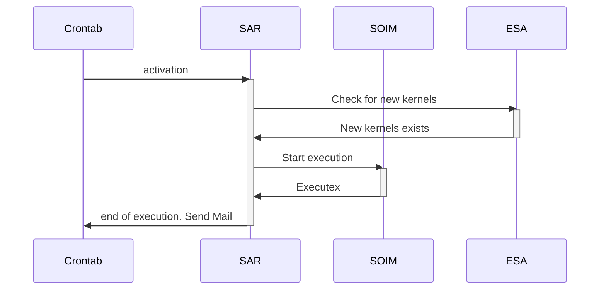
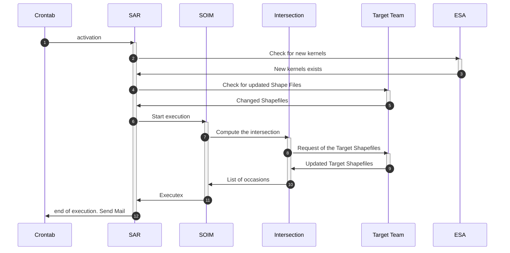

# SOIM

[](#tests)


# Install

From the repository root, install the locked dependencies and run the CLI with uv.

```console
uv sync --locked
uv run --locked soim --help
uv run --locked soim about
uv run --locked soim-starter --help
```

Use `uv add <package>` and `uv remove <package>` to update `pyproject.toml` and `uv.lock` together.

Build the source distribution and wheel with `uv build`.

## Run configuration

Copy [`soim.example.toml`](soim.example.toml) to `soim.toml` and adapt it to your
installation. SOIM reads `soim.toml` from the current directory by default.
Use `--config` to load a different TOML file.

The file accepts two optional top-level settings.

| Key | Purpose | Default when omitted |
| --- | --- | --- |
| `project_list` | Path to a YAML mapping of project names to project directories. Used by `soim list` and `soim run`. The example selects the repository's HRIC project through `project_list.yml`. | `projects/project_list.yml` |
| `metakernel` | Path to a local SPICE metakernel file used by `soim run` and `soim-starter`. Replace the example path with your own. | Latest BepiColombo MPO metakernel from ESA |

Relative paths in the TOML file are resolved from the directory containing it.

```console
cp soim.example.toml soim.toml
uv run --locked soim --config soim.toml list
```

After setting the metakernel path, run `uv run --locked soim --config soim.toml run`.
For each setting, the environment variable takes precedence over the CLI option,
followed by the value in TOML.

| Environment | CLI option | TOML key |
| --- | --- | --- |
| `SOIM_PROJECT_LIST` | `--project-list` | `project_list` |
| `SOIM_METAKERNEL` | `--metakernel` | `metakernel` |

For a local metakernel, relative `PATH_VALUES` are resolved from the
metakernel's directory. Referenced kernels must already be available locally.

Use `soim list` to check the project list before running. `soim run` applies
the daylight filter and writes results and logs to the output directory
(`output_soim` by default).

The installed `soim-starter` command uses the same metakernel settings. Select its single
project directory with `--project` and its output directory name with `--name`.
The default output directory is `my_project_results` inside the project.
Use `--dayside` to restrict the standalone run to sunlit acquisitions.
By default it also processes night-side acquisitions, as in SOIM 2026 v4.0.

```console
uv run --locked soim-starter --project projects/01_HRIC --config soim.toml
```

The earlier `uv run python SOIM_starter.py` invocation remains available from a source checkout.

For long timelines, use `--workers 4` to distribute contiguous blocks across
four processes. Each process loads the metakernel once, and the starter writes
the results in timeline order. By default, the starter uses the number of
available CPU cores minus one, with a minimum of one worker.

## Project files and outputs

Each project directory contains one `instruments*.yml`, `scenario*.yml`,
`timeline*.txt` and `products*.csv` file. A timeline row contains the UTC
start, sampling interval in seconds, UTC stop and one or more instrument names.

```text
13-Mar-2027 00:27:20|1|13-Mar-2027 00:32:20|MPO_SIMBIO-SYS_HRIC_FPAN
```

The fourth field of `products.csv` selects where each product mode is exported.
Use `c` for CSV, `s` for shapefile attributes and `b` for both. Legacy numeric
formats select both outputs.

The standalone starter writes `tot_timeline.csv` and the shapefile under
`<project>/<name>/results`. The first three CSV rows identify instruments,
products and units. Each acquisition has a UTC timestamp and an ephemeris time
in TDB seconds from J2000. SOIM corrects seams and polar geometry in the
shapefile export. A footprint split at the antimeridian stays one multipart
feature, with the same timestamp and attributes as the original acquisition.

Single-instrument timelines are computed and written in blocks. SOIM stages
the CSV and shapefile components until the export completes. A run reports
the total elapsed time after writing the results.

## Tests

Run the suite from the repository root. Coverage includes the `SOIM` package
and the compatibility wrapper. The coverage badge indicates the minimum checked
by the full-suite command.

```console
uv sync --locked
uv run --locked python -m pytest --cov --cov-report=term-missing --cov-fail-under=80
```

The tests use local fixtures and controlled SPICE geometry. They cover
configuration precedence, local metakernels, the daylight filter, product
modes, CSV and shapefile export, the installed starter entry point and its
wrapper, worker startup and block ordering, and polar and antimeridian
corrections. No mission kernel download is needed. Update the README version
badge when changing the package version.





## Future Version


